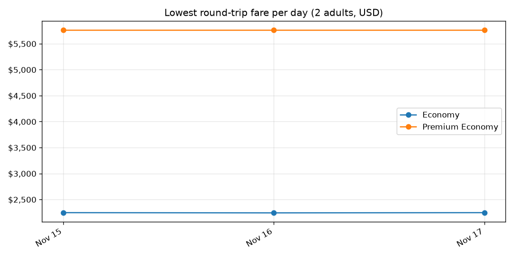

# Chicago → London fare tracker

Trip: out Tue Jun 15, Wed Jun 16, Thu Jun 17; back Sat Jun 19, Sun Jun 20, Mon Jun 21 · 2 adults · up to 1 stop(s) · American, United, Aer Lingus, British Airways, Virgin Atlantic
Outbound must land in London by 10:00 AM on Jun 18.

**Last run:** 2026-11-17T19:28:18Z UTC · 18 searches ok, 0 not bookable yet, 0 failed

Prices are the round-trip fare for the whole party as quoted by Ignav (USD).

## Economy

**Today's best: $2,246** · British Airways · out Tue Jun 15 (ORD-YUL-LHR, lands 09:40) · back Mon Jun 21 (LHR-DUB-ORD)

vs last check: ▲ $4 · vs 7-day avg ($2,244): +0.1% · lowest seen: $2,242 on 2026-11-16 · days tracked: 3

| Out \ Back | Sat Jun 19 | Sun Jun 20 | Mon Jun 21 |
|---|---|---|---|
| Tue Jun 15 | $2,514 AA | $2,680 VS | $2,246 BA |
| Wed Jun 16 | $2,514 BA | $2,680 VS | $2,246 BA |
| Thu Jun 17 | $2,654 AA | $2,712 AA | $2,602 AA |

Cheapest today by airline: British Airways $2,246 · American $2,462 · United $2,462 · Virgin Atlantic $2,680
No qualifying fares today: Aer Lingus

## Premium Economy

**Today's best: $5,766** · British Airways · out Tue Jun 15 (ORD-MCO-LGW, lands 06:50) · back Sat Jun 19 (LGW-MCO-ORD)
Fare type: **Premium Economy** via American · [booking link](https://www.aa.com/goto/metasearch?ITEN=GOOGLE,HECZaMkZzStcAAD8iQBD--------vtbgv16AAAAAGr8q6ALCBDwA,US,roundTrip,4,A2S0C0I0Y0L0,1,ORD,0,LGW,0,false,1813077480000,false,1813411800000,0,0,1780.00,1,%23AA%7C2288%7CH%7CORD%7CMCO%7C1813077480000%7C0%7COHX9C9P5%23AA%7C7011%7CP%7CMCO%7CLGW%7C1813094100000%7C0%7COHX9C9P5%23AA%7C6931%7CP%7CLGW%7CMCO%7C1813411800000%7C1%7COKW9C9P5%23AA%7C1611%7CH%7CMCO%7CORD%7C1813487400000%7C1%7COKW9C9P5&locale=en_US&c=MSE%7CGFS%7C20261117%7CDST%7CDST%7CWEB%7C%7CHPPH%7CHPPH%7CGFSE-0_1_0_2&dp=true&gclid=AAcRjHJ_wwhovT3E-6XkBJXH8XG45_z6MtPOtRlLgUxjve0ilr9iuHiqtQy5WjN033_y_t_xuMTrE_YgRH8Z-l126mT7MSQwmZWeJco92D-CKPRY1mA&gclsrc=gf)

vs last check: = $0 · vs 7-day avg ($5,766): +0.0% · lowest seen: $5,766 on 2026-11-15 · days tracked: 3

🔔 **Lowest price seen so far.**

| Out \ Back | Sat Jun 19 | Sun Jun 20 | Mon Jun 21 |
|---|---|---|---|
| Tue Jun 15 | $5,766 BA | $5,962 AA | — |
| Wed Jun 16 | $5,766 BA | $5,959 BA | $5,962 BA |
| Thu Jun 17 | $6,866 AA | $7,665 BA | $7,209 AA |

Cheapest today by airline: British Airways $5,766 · American $5,962 · United $6,445
No qualifying fares today: Aer Lingus, Virgin Atlantic

## Trend

